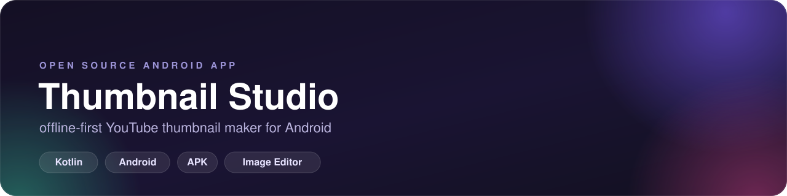

<div align="center">




<a href="https://github.com/technicalnihilist-lgtm/youtube-thumbnail-maker/stargazers"></a>&nbsp;<a href="https://github.com/technicalnihilist-lgtm/youtube-thumbnail-maker/network/members"></a>

<a href="https://github.com/technicalnihilist-lgtm/youtube-thumbnail-maker/releases/latest"></a>

<b>Support the work</b>

  

<sub>Donations aren't live yet — Paytm, UPI, PayPal and Buy&nbsp;Me&nbsp;a&nbsp;Coffee all show <b>coming soon</b>. Until then, a ⭐ star is the best support.</sub>

<a href="https://github.com/technicalnihilist-lgtm/youtube-thumbnail-maker/releases/latest"></a>  <a href="https://github.com/technicalnihilist-lgtm/youtube-thumbnail-maker/releases"></a>

</div>

---

## On-device AI (1.1.0)

Two real machine-learning models run on the phone. Nothing is uploaded, there is no API key,
no account and no cloud inference:

| Feature | Model | Where it runs |
| --- | --- | --- |
| **AI cutout** — lift the subject out of a photo | ML Kit Subject Segmentation | On device; model delivered by Google Play services |
| **AI text** — read text already in a photo into an editable layer | ML Kit Text Recognition (Latin) | On device; model delivered by Google Play services |

Both models are delivered by Google Play services instead of being bundled, which keeps the APK
at ~7 MB; the first use of an AI feature may let Play services fetch the model once, and after
that inference is fully offline. Both features degrade gracefully: if Play services is missing,
the AI cutout explains itself and the flood-fill cutout plus the manual erase brush still work. `AiText` cleans the raw OCR output
(picks the likely headline, drops noise, respects a 90-character budget) and is unit tested.

## What is rule-based (and what is not AI)

The "Smart" tab is deliberately **not** generative AI — it is deterministic design maths, and the
app labels it that way:

| Tool | How it actually works |
| --- | --- |
| Contrast checker | WCAG 2.1 relative-luminance maths |
| Auto-fix contrast | Picks black/white text against the sampled backdrop |
| Palette generator | Colour-harmony rotation (complementary / analogous / triadic / mono) |
| Palette from design | Bucketed colour quantisation of the backdrop |
| Smart layouts | Four rule-based composition templates |
| Background cutout (manual) | Edge flood-fill ("magic wand") chroma removal — the AI cutout above is the ML path |
| Erase brush | Manual per-pixel masking |
| Adjustments | `ColorMatrix` grading + 3×3 unsharp kernel |

If a tool is not AI, the app does not call it AI.

## Features

**Text**
Multiple text layers, 8 bundled typefaces plus custom `.ttf`/`.otf` import, bold/italic/underline/uppercase, letter and line spacing, three alignments, rotation, curved (arc) text, gradient fill, outline, drop shadow, glow, extruded 3D depth, background highlight boxes, and automatic shrink-to-fit so text never overflows its box. Eight style presets (gaming, music, tech, education, vlog, news, cinematic, 3D pop).

**Images**
Gallery import (Photo Picker, no permissions), replace, corner radius, border, horizontal flip, brightness / contrast / saturation / hue / sharpness, **on-device AI subject cutout**, colour-background cutout, manual erase brush, **on-device AI text extraction**, EXIF-correct decoding, memory-bounded bitmap cache.

**Shapes & stickers**
Rectangle, rounded rectangle, ellipse, triangle, star, burst, arrow, line, frame, badge, speech bubble, heart — solid or gradient fill, border, rotation. 24 emoji stickers that scale and rotate.

**Canvas & workflow**
Pinch-to-zoom (0.6×–8×), pan, drag / resize / rotate handles with hit-testing, snap to centre guides, grid, safe-area overlay, layers panel with visibility, lock, reorder, duplicate, delete; 40-step undo/redo; debounced autosave; project reopening; duplicate design; save any design as a reusable template.

**Templates**
15 original templates generated in code (so they cost the APK almost nothing and nothing is downloaded): Gaming, Music, Technology, Education, Vlogs, Cinematic, News, Reviews, Podcast, Entertainment. All elements stay editable.

**Export**
1280 × 720 PNG (lossless) or JPEG (quality slider), MediaStore write on Android 10+, app-private file plus sharesheet on older versions, background rendering off the main thread, YouTube feed-size preview in the editor.

## Install

Download the APK from the [latest release](../../releases/latest) and open it on the phone (allow "install unknown apps" for your browser/file manager). Requires Android 7.0 (API 24) or newer.

The published APK is signed with the project's local debug key so it installs without shipping any signing secrets. See *Release signing* below.

## Build from source

Requirements: JDK 17, Android SDK with `platforms;android-34` and `build-tools;34.0.0`.

```bash
git clone https://github.com/technicalnihilist-lgtm/youtube-thumbnail-maker.git
cd thumbnail-studio
./gradlew :app:assembleDebug      # app/build/outputs/apk/debug/app-debug.apk
./gradlew :app:assembleRelease    # app/build/outputs/apk/release/app-release.apk
./gradlew :app:testDebugUnitTest  # 23 unit tests
```

`local.properties` (not committed) may point at your SDK:

```properties
sdk.dir=/path/to/Android/Sdk
```

## Architecture

```
app/src/main/java/com/thumbnailstudio/app/
├── model/      Model.kt        Immutable Project/Layer document + transforms
├── render/     ThumbnailRenderer.kt  Single renderer for preview, feed preview, export
│               TextRenderer.kt       StaticLayout text, effects, arc text
│               ShapePaths.kt         Vector geometry for all shapes
│               ImagePipeline.kt      Decode, EXIF, ColorMatrix grading, sharpen, blur, cache
│               Cutout.kt             Flood-fill cutout + manual eraser
├── data/       ProjectStore.kt  JSON documents, atomic writes, thumbnails, imports
│               Templates.kt     Programmatic template library
│               SettingsStore.kt SharedPreferences-backed preferences
├── tools/      SmartTools.kt    WCAG contrast, palettes, layouts, scoring
├── export/     Exporter.kt      MediaStore + FileProvider + sharesheet
├── update/     UpdateChecker.kt Optional GitHub Releases check
└── ui/         Compose screens: home, templates, projects, editor, settings
```

**AI layer.** `ai/OnDeviceAi.kt` wraps the two ML Kit tasks in coroutines with cancellation and
error handling; `ai/AiText.kt` is pure Kotlin post-processing with no Android types, so it is
unit-tested like the rest of the logic.

**Why this shape.** The document is immutable data; the editor mutates it through a controller that owns undo/redo snapshots. One renderer draws the interactive canvas, the small feed preview and the exported file, so preview and export can never drift apart. Layers live in a fixed 1280 × 720 coordinate space and are drawn through a single canvas scale, which keeps hit-testing, handles and export maths identical.

**Storage.** Projects are individual JSON documents (kotlinx.serialization) written atomically to app storage. This avoids Room/KSP codegen — a measurable build-time and APK-size saving — while still being crash-safe. Images are copied into app storage on import; nothing is ever referenced from another app's sandbox.

**Memory.** Bitmaps decode downsampled to a 1600 px bound, are cached in an `LruCache` sized to a quarter of the heap, and the cache is flushed from `onTrimMemory`/`onLowMemory`. Export renders one 1280 × 720 bitmap off the main thread.

## Tests

`app/src/test/...` covers the parts that are pure logic and therefore worth pinning (29 cases):

- project add/replace/duplicate/reorder/visibility
- layer translate, uniform scale (with text-size coupling), rotation normalisation
- JSON round-trip of the sealed layer hierarchy
- every template builds valid, uniquely-identified layers; category coverage
- WCAG contrast ratios, readability bands, best foreground colour
- palette quantisation, harmony generation, hex round-trip
- auto-contrast fix raises the score, layout suggestions keep layers on canvas
- export filename sanitisation
- semantic version comparison for the update checker

```
> Task :app:testDebugUnitTest
29 tests completed
```

## Release signing

The repository contains no keystore and no secrets. The release build is signed with the standard local debug key so that CI and local builds produce an installable artifact:

```kotlin
release { signingConfig = signingConfigs.getByName("debug") }
```

For a Play-Store-style release, generate your own keystore and either add a `signingConfigs.release` block reading from environment variables, or provide the four standard Gradle properties in CI secrets (`SIGNING_KEY_ALIAS`, `SIGNING_KEY_PASSWORD`, `SIGNING_STORE_PASSWORD`, and the base64 keystore). Never commit the keystore.

## Updates

Settings → Updates performs an optional GitHub Releases check (needs internet). It compares `versionName` with the latest release tag and offers the APK download link. Editing never requires it.

## Privacy

No analytics, no ads, no accounts, no telemetry, no third-party SDKs beyond AndroidX/Compose and
the two on-device ML Kit tasks. `INTERNET` is declared only for the optional update check. Photos,
text and projects never leave the device — the AI runs locally.

## Licence

No licence file is included: choose one (MIT, Apache-2.0, GPL-3.0 …) before distributing publicly.

---

---

## 🌍 Languages

<sub>Donations are <b>coming soon</b> in every language below — nothing to pay today, nothing to click.</sub>

<div align="center">

<sub><b>हिन्दी · বাংলা · मराठी · తెలుగు · தமிழ் · ગુજરાતી · ಕನ್ನಡ · മലയാളം · ਪੰਜਾਬੀ · ଓଡ଼ିଆ · অসমীয়া · اردو</b></sub>

</div>

<details>
<summary><b>🌍 Open the same message in 53 languages</b></summary>

**🇮🇳 Indian languages**

- **हिन्दी** (Hindi) — ☕ जल्द ही आ रहा है। · ⭐ अगर आपको यह ऐप और हमारा काम पसंद है, तो कृपया रिपॉजिटरी को स्टार दें और हमें फॉलो करें।
- **বাংলা** (Bengali) — ☕ খুব শিগগিরই আসছে। · ⭐ যদি আপনার এই অ্যাপ এবং আমাদের কাজ ভালো লাগে, তবে অনুগ্রহ করে রিপোজিটরিটিকে একটি স্টার দিন এবং আমাদের ফলো করুন।
- **मराठी** (Marathi) — ☕ लवकरच येत आहे. · ⭐ जर तुम्हाला हे ॲप आणि आमचं काम आवडलं असेल, तर कृपया रिपॉझिटरीला स्टार द्या आणि आम्हाला फॉलो करा.
- **తెలుగు** (Telugu) — ☕ త్వరలో రాబోతోంది. · ⭐ మీకు ఈ యాప్, మా పని నచ్చితే, దయచేసి రిపోజిటరీకి ఒక స్టార్ ఇచ్చి మమ్మల్ని ఫాలో అవ్వండి.
- **தமிழ்** (Tamil) — ☕ விரைவில் வருகிறது. · ⭐ உங்களுக்கு இந்த ஆப்பும் எங்க வேலையும் பிடிச்சிருந்தா, தயவுசெஞ்சு இந்த ரெபாசிட்டரிக்கு ஒரு ஸ்டார்…
- **ગુજરાતી** (Gujarati) — ☕ ટૂંક સમયમાં આવી રહ્યું છે. · ⭐ જો તમને આ એપ અને અમારું કામ ગમતું હોય, તો પ્લીઝ રિપોઝિટરીને સ્ટાર આપો અને અમને ફોલો કરો.
- **ಕನ್ನಡ** (Kannada) — ☕ ಶೀಘ್ರದಲ್ಲೇ ಬರುತ್ತಿದೆ. · ⭐ ನಿಮಗೆ ಈ ಆ್ಯಪ್ ಮತ್ತು ನಮ್ಮ ಕೆಲಸ ಇಷ್ಟವಾದರೆ, ದಯವಿಟ್ಟು ರೆಪೊಸಿಟರಿಗೆ ಸ್ಟಾರ್ ಕೊಡಿ ಮತ್ತು ನಮ್ಮನ್ನು ಫಾಲೋ ಮಾಡಿ.
- **മലയാളം** (Malayalam) — ☕ ഉടൻ വരുന്നു. · ⭐ നിങ്ങൾക്ക് ഈ ആപ്പും ഞങ്ങളുടെ പ്രവർത്തനവും ഇഷ്ടപ്പെട്ടെങ്കിൽ, ദയവായി റെപ്പോസിറ്ററിക്ക് ഒരു സ്റ്റാർ…
- **ਪੰਜਾਬੀ** (Punjabi) — ☕ ਜਲਦੀ ਆ ਰਿਹਾ ਹੈ। · ⭐ ਜੇ ਤੁਹਾਨੂੰ ਇਹ ਐਪ ਅਤੇ ਸਾਡਾ ਕੰਮ ਪਸੰਦ ਹੈ, ਤਾਂ ਕਿਰਪਾ ਕਰਕੇ ਰਿਪੋਜ਼ਟਰੀ ਨੂੰ ਸਟਾਰ ਦਿਓ ਅਤੇ ਸਾਨੂੰ ਫਾਲੋ ਕਰੋ।
- **ଓଡ଼ିଆ** (Odia) — ☕ ଖୁବ୍ ଶୀଘ୍ର ଆସୁଛି। · ⭐ ଯଦି ଆପଣଙ୍କୁ ଏହି ଆପ୍ ଏବଂ ଆମର କାମ ଭଲ ଲାଗୁଛି, ତେବେ ଦୟାକରି ରିପୋଜିଟୋରୀକୁ ଗୋଟିଏ ଷ୍ଟାର୍ ଦିଅନ୍ତୁ ଏବଂ ଆମକୁ ଫଲୋ କରନ୍ତୁ।
- **অসমীয়া** (Assamese) — ☕ অতি সোনকালেই আহি আছে। · ⭐ যদি আপুনি এই এপটো আৰু আমাৰ কাম ভাল পায়, তেন্তে অনুগ্ৰহ কৰি ৰিপজিটৰীটোক এটা ষ্টাৰ দিয়ক আৰু আমাক ফ'ল' কৰক।
- **اردو** (Urdu) — ☕ جلد آرہا ہے۔ · ⭐ اگر آپ کو یہ ایپ اور ہمارا کام پسند آئے تو براہ کرم ریپازٹری کو سٹار دیں اور ہمیں فالو کریں۔
- **संस्कृतम्** (Sanskrit) — ☕ शीघ्रमेव आगच्छति।
- **मैथिली** (Maithili) — ☕ जल्दिये आबि रहल अछि।
- **कोंकणी** (Konkani) — ☕ रोखडेंच येता.
- **کٲشُر** (Kashmiri) — ☕ جَلدی یِوان چھُ۔
- **سنڌي** (Sindhi) — ☕ जल्द अची रह्यो आहे।
- **डोगरी** (Dogri) — ☕ जल्दी आ करदा ऐ।
- **ꯃꯤꯇꯩ ꯂꯣꯟ** (Manipuri) — ☕ ꯑꯊꯨꯕꯥ ꯃꯇꯝꯗꯥ ꯂꯥꯛꯀꯅꯤ꯫
- **बर’** (Bodo) — ☕ थाबैनो फैगोन।
- **ᱥᱟᱱᱛᱟᱲᱤ** (Santali) — ☕ ᱞᱚᱜᱚᱱ ᱦᱤᱡᱩᱜ ᱠᱟᱱᱟ᱾
- **नेपाली** (Nepali) — ☕ छिट्टै आउँदैछ। · ⭐ यदि तपाईंलाई यो एप र हाम्रो काम मन पर्‍यो भने, कृपया रिपोजिटरीलाई स्टार दिनुहोस् र हामीलाई फलो गर्नुहोस्।

**🌍 World languages**

- **العربية** (Arabic) — ☕ قريبًا. · ⭐ إذا أعجبك هذا التطبيق وعملنا، فيرجى منح المستودع نجمة ومتابعتنا.
- **简体中文** (Chinese (Simplified)) — ☕ 即将推出。
- **繁體中文** (Chinese (Traditional)) — ☕ 即將推出。
- **Čeština** (Czech) — ☕ Již brzy.
- **Dansk** (Danish) — ☕ Kommer snart.
- **Nederlands** (Dutch) — ☕ Binnenkort beschikbaar. · ⭐ Vind je deze app en ons werk leuk?
- **Filipino** (Filipino) — ☕ Malapit na.
- **Suomi** (Finnish) — ☕ Tulossa pian.
- **Français** (French) — ☕ Bientôt disponible. · ⭐ Si cette application et notre travail vous plaisent, mettez une étoile au dépôt et suivez-nous.
- **Deutsch** (German) — ☕ Bald verfügbar. · ⭐ Wenn dir diese App und unsere Arbeit gefallen, gib dem Repository einen Stern und folge uns.
- **Ελληνικά** (Greek) — ☕ Έρχεται σύντομα.
- **עברית** (Hebrew) — ☕ בקרוב.
- **Magyar** (Hungarian) — ☕ Hamarosan.
- **Bahasa Indonesia** (Indonesian) — ☕ Segera hadir. · ⭐ Jika kamu suka aplikasi ini dan karya kami, beri bintang pada repositori ini dan ikuti kami.
- **Italiano** (Italian) — ☕ In arrivo.
- **日本語** (Japanese) — ☕ 近日公開。 · ⭐ このアプリと私たちの仕事が気に入ったら、リポジトリにスターを付けてフォローしてください。
- **한국어** (Korean) — ☕ 곧 공개됩니다. · ⭐ 이 앱과 저희 작업이 마음에 드신다면 저장소에 스타를 눌러 주시고 팔로우해 주세요.
- **Bahasa Melayu** (Malay) — ☕ Akan datang.
- **Norsk** (Norwegian) — ☕ Kommer snart.
- **فارسی** (Persian) — ☕ به‌زودی.
- **Polski** (Polish) — ☕ Wkrótce. · ⭐ Jeśli podoba Ci się ta aplikacja i nasza praca, daj repozytorium gwiazdkę i obserwuj nas.
- **Português** (Portuguese) — ☕ Em breve.
- **Română** (Romanian) — ☕ În curând.
- **Русский** (Russian) — ☕ Скоро. · ⭐ Если вам нравится это приложение и наша работа, поставьте звёздочку репозиторию и подпишитесь на нас.
- **Español** (Spanish) — ☕ Muy pronto. · ⭐ Si te gusta esta app y nuestro trabajo, dale una estrella al repositorio y síguenos.
- **Kiswahili** (Swahili) — ☕ Inakuja hivi karibuni.
- **Svenska** (Swedish) — ☕ Kommer snart.
- **ไทย** (Thai) — ☕ เร็ว ๆ นี้
- **Türkçe** (Turkish) — ☕ Çok yakında.
- **Українська** (Ukrainian) — ☕ Незабаром.
- **Tiếng Việt** (Vietnamese) — ☕ Sắp ra mắt. · ⭐ Nếu bạn thích ứng dụng này và công việc của chúng tôi, hãy tặng kho lưu trữ một ngôi sao và theo…

</details>

